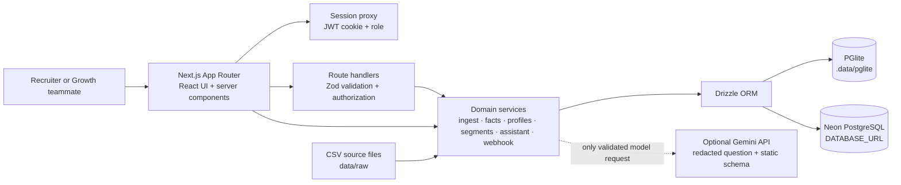

# Carafe build guide

This guide explains the code that is in this repository: how a request moves through the app, how records are stored and linked, what the API can create/read/update/delete, which edge cases the implementation handles, how the tests prove it, and how to deploy it. It is a companion to the more normative [PRD](../PRD.md), [README](../README.md), and [deployment guide](DEPLOY.md).

## The short version

Carafe is a small, single-team customer data platform (CDP) for The Pour Over. It combines synthetic newsletter, website, and app records into a PostgreSQL database; links identities where the input supports a reliable match; and gives a recruiter or Growth teammate a dashboard, lookup, segments, live event feed, and plan-only question assistant.

The application is a full-stack Next.js app. The browser renders React pages and calls same-origin route handlers. The server validates requests, authenticates sessions, runs the domain logic, and queries Postgres through Drizzle. No database credential belongs in browser code.

**Database answer:** local development uses PGlite files in `.data/pglite`. A deployed app uses a PostgreSQL database whose connection URL is `DATABASE_URL`; the intended production provider in this project is **Neon**. This repo does **not** use Supabase. The app has no Supabase Auth, Storage, Realtime, or client SDK integration.

## Architecture at a glance

The database branch is selected in [`src/lib/db.ts`](../src/lib/db.ts): when `DATABASE_URL` exists, the app constructs Drizzle with `@neondatabase/serverless` and `drizzle-orm/neon-http`; otherwise it opens PGlite at `.data/pglite`. Both branches expose the same typed Drizzle query builder. `PGlite` is a developer convenience, not a hosted or shared production database.

## Technology stack and why it is here

| Layer | Choice in this repository | Responsibility |
|---|---|---|
| Web framework | Next.js 16 App Router | Server-rendered pages, client interactions, route handlers, production runtime integration. |
| UI | React 19, TypeScript strict mode, Tailwind CSS 4 | Accessible responsive screens and typed components. A small set of custom tokens/components provides the editorial look. |
| Illustration | Three.js + React Three Fiber | Lazy-loaded landing-page pour illustration; static SVG fallback for reduced motion or unsupported WebGL. |
| Validation | Zod 4 | Parses untrusted HTTP payloads, persisted segment filters, and model plans at boundaries. |
| Database access | Drizzle ORM | Typed PostgreSQL schema and query builder; no raw SQL assembled from user/model strings. |
| Local database | PGlite 0.5 | Embedded PostgreSQL-compatible engine for local development/tests. Persistent local files live under ignored `.data/`. |
| Hosted database | Neon PostgreSQL + `@neondatabase/serverless` | The intended free-tier production Postgres. The app switches to it when `DATABASE_URL` is set. |
| Authentication | `jose` JWT in an HTTP-only cookie; Node `scrypt` for admin password check | Eight-hour server-verified sessions with `admin` and `viewer` roles. This is app auth, not Supabase Auth. |
| CSV | `csv-parse` | Parses the three synthetic assessment datasets while preserving row numbers for quarantine diagnostics. |
| Tests | Vitest 5 + isolated in-memory PGlite | Unit, integration, golden-number, privacy-boundary, and security checks. |
| Optional assistant provider | Gemini through a small `LlmClient` adapter | Generates a structured audience-query plan. It must not receive customer data. Rules fallback works without provider credentials. |

Dependencies and runnable commands are listed in [`package.json`](../package.json). Build and deployment should use the Node version and commands in the README.

### Milestone map

The implemented sequence follows `PROMPTS.md`: **M0** app shell/design/auth → **M1** schema, ingest, and data rules → **M2** signed webhook → **M3** lookup and live feed → **M4** segments → **M5** PII-safe assistant → **M8** hardening/deployment docs → **M6** overview/data quality → **M7** public landing/3D scene. The prompt order places hardening before the final overview and landing work.

## Frontend: pages and user journeys

The App Router files under `src/app/` correspond to browser paths:

| Path | Purpose |
|---|---|
| `/` | Public landing page, aggregate proof points, recruiter demo sign-in, and manual sign-in section. |
| `/login` | Redirects to `/#login`; it is a compatibility entry point, not a second login screen. |
| `/app` | Authenticated overview: subscriber/cold/source counts, stitching impact, live activity, and cold-list cost estimate. |
| `/app/lookup` | Search by email fragment or visitor/app/device ID; five server-masked recruiter sample emails; search results masked by default. |
| `/app/lookup/{type}/{id}` | Full profile with newsletter facts, linked web/app activity, linking reasons, journey, and timeline. Full email is visible here to authenticated teammates. |
| `/app/segments` | Filter builder, live preview, save, list saved segments, and export CSV. |
| `/app/live` | Polls the recent event endpoint and links resolvable activity to profiles. |
| `/app/assistant` | Suggested audience questions and validated answer/plan output. |
| `/app/data-quality` | Quarantine reasons, duplicate merge count, anonymous/unlinked visitors, and identity conflict metrics. |
| `/dev/styleguide` | Internal UI style reference; not part of the recruiter’s main workflow. |

Most app pages use `AppNavigation`. The public landing scene is split between [`pour-scene.tsx`](../src/components/pour-scene.tsx) and [`pour-scene-canvas.tsx`](../src/components/pour-scene-canvas.tsx); keeping the canvas dynamically loaded keeps the large Three.js chunk out of the initial page bundle.

### Lookup sample behavior

The server loads five deterministic subscriber records and passes the browser only the subscriber UUID, masked email label, status, and source. The raw email is not included in those sample option props. Selecting an option sends its UUID in a JSON POST body to `/api/profiles/search`; it does not put an email in the address bar. The result is rendered masked by default. “Open full profile” navigates by UUID and the authorized profile page displays the full reader record. The existing “Reveal emails” control can reveal result-list emails for the current view.

## Backend: request path and important code

1. `src/proxy.ts` allows the small public route set and verifies the signed session cookie on other paths. Browser pages without a session redirect to `/login`; private API requests receive `401`.
2. Route handlers parse JSON/form parameters with Zod, apply same-origin checks where a browser mutation is expected, check the role where an admin operation is required, and return status codes rather than raw exceptions.
3. Domain services in `src/lib/` implement identity resolution, score/cold facts, profile lookup, segment filtering, assistant planning, webhook verification, CSV formatting, and erasure.
4. `src/lib/db/schema.ts` is the Drizzle schema. Migrations are under `drizzle/`; the schema is shared by both PGlite and hosted Postgres.
5. Logs go through `src/lib/log.ts`. Security events use redacted messages and outcome enums. Payload bodies are not logged.

### API and CRUD map

“CRUD” is not a generic admin CRUD console here. The API exposes specific use-case operations and intentionally has no subscriber create/update screen.

| Method + path | What it does | Access / side effects |
|---|---|---|
| `POST /api/auth/login` | Validate credentials and create a session. | Public; same-origin checked; rate limited; sets an HTTP-only, `SameSite=Lax` cookie (secure in production). |
| `POST /api/auth/logout` | Expire the session cookie and redirect to `/login` with HTTP 303. | Same-origin checked. `/login` then redirects to the landing sign-in section. |
| `GET /api/health` | Run a lightweight database query. | Public liveness/connectivity check; does not expose database contents. |
| `POST /api/profiles/search` | Search by email fragment, exact supported visitor/app/device ID, or a recruiter sample UUID. | Authenticated; request data is in JSON body, not query string. Returns masked-on-screen hits with opaque profile links. |
| `GET /app/lookup/{type}/{id}` | Read one subscriber, app-only, or visitor profile and linked activity. | Authenticated page; subscriber IDs are UUIDs; app/visitor IDs are HMAC-derived opaque tokens. |
| `GET /api/profiles/{type}/{id}` | Return profile JSON for authenticated app clients. | Same proxy authentication; route validates type and UUID/HMAC-token format; 404 for invalid/not found. |
| `DELETE /api/profiles/{subscriber\|app\|visitor}/{id}` | Erase the selected profile and linked rows. | Admin only. Child rows are removed before parent rows. Multiple statements are used; the Neon HTTP driver does not provide interactive transactions. |
| `POST /api/segments/preview` | Validate filters, compute count and one page of matches. | Authenticated through proxy; no writes. Page size defaults to 50. |
| `GET /api/segments` | Read saved segment definitions. | Session required. |
| `POST /api/segments` | Create a named segment with a strict validated JSON filter. | Same-origin and session required. Viewer accounts are limited to 10 saved segments each. |
| `GET /api/segments/{id}/export.csv` | Recompute saved filter and stream CSV. | Session required; viewer exports over 5,000 rows are rejected; formula cells are neutralized. |
| `GET /api/events/recent` | Return recent event labels, masked profile labels, and delivery counters. | Session required through proxy; optional `since` timestamp is Zod-validated. |
| `POST /webhooks/app` | Verify and ingest an app event. | Public machine-to-machine endpoint; HMAC signature, timestamp, size, schema, replay, and rate checks. Idempotent by event ID. |
| `POST /api/demo/send-test-event` | Create and sign a synthetic demo event through the same webhook handler. | Session + same-origin; rate limited; needs `WEBHOOK_SECRET`. |
| `POST /api/assistant` | Redact a question, request/produce a plan, execute locally, and audit the redacted request. | Session + same-origin; daily limits by session and hashed IP. |

Not currently implemented: update or delete saved segments, arbitrary subscriber editing, a public re-seed endpoint, email sending, payment flows, real beehiiv/app integrations, multi-tenancy, or a Supabase integration. Seed/maintenance remains a CLI operation.

Profile erasure applies to a canonical subscriber and its linked graph, or an app-only/visitor-only profile. An app/visitor identity already attached to a subscriber is not independently erasable from that identity-specific route; use the canonical subscriber erasure path so the linked person is handled consistently.

## Data model and where data lives

The canonical definitions are in [`src/lib/db/schema.ts`](../src/lib/db/schema.ts). There are no Supabase tables in use.

The derived `SubscriberFact` read model is currently assembled in TypeScript by `getSubscriberFacts()` rather than stored as a materialized table or SQL view. It fetches the current tables, links activity in memory, and computes cold/engagement fields. This is easy to reason about for the supplied ~2,900 subscribers and works consistently across dashboard, lookup/segments, and assistant, but it is a clear scale boundary: at much larger data volumes, push filtering/aggregation into SQL and page the underlying reads rather than loading broad table sets per request.

| Table | Main contents and relationships |
|---|---|
| `subscribers` | One normalized unique email per newsletter reader; UUID primary key, signup/status/source/last-open, merged duplicate count. |
| `visitors` | Website visitor identity, optional email, optional subscriber link, first-seen and conflict flag. |
| `web_events` | Page-view rows linked to visitor; timestamps interpreted as UTC; unique `row_key` makes seed re-runs idempotent; `email_captured` stores a boolean, not the email. |
| `app_users` | App identity, optional email and subscriber link; origin is `csv` or `webhook`. Unmatched users remain app-only. |
| `device_links` | Device-to-user association; earliest event time wins. |
| `app_events` | Event ID (primary/idempotency key), allowed event enum, optional user ID, device ID, occurred/received timestamps, scrubbed properties. |
| `webhook_deliveries` | One outcome record for accepted/duplicate/rejected webhook deliveries; does not store rejected bodies. |
| `identity_conflicts` | De-duplicated conflict metadata, such as device/user disagreement, visitor/email mismatch, or reused event ID with a different payload. |
| `quarantine` | Source file, source row number, raw row JSON, and reason for data that could not safely enter a canonical table. It can contain email PII and is admin-sensitive. |
| `segments` | Saved segment name, validated filter JSON, creator username, creation time. |
| `assistant_audit` | Redacted question, validated plan or null, outcome/provider/session hash; never the seed/query result rows. |
| `rate_limits` | Fixed-window counter key and count. Keys use usernames or hashed IDs/IPs where applicable, not raw request bodies. |

| Environment | Durable data location | What persists |
|---|---|---|
| Local, `DATABASE_URL` unset | `.data/pglite/` under the repository working directory; this folder is gitignored. | Seeded data, local changes, demo webhook activity, saved segments, rate limits, assistant audits. Back up this folder if the local state matters. |
| Hosted, `DATABASE_URL` set | The PostgreSQL project encoded by that connection URL; intended provider is Neon. | Same relational data tables. Vercel/Netlify only run the app; they do not store this application’s durable relational records. |
| Source data | `data/raw/*.csv` in the repo | The synthetic assessment inputs used by `npm run seed`; it is not the live application database. Never replace with real reader data in a public repo. |
| Runtime/build files | `.next/`, `node_modules/`, `.env.local` | Generated or machine-local, not the production source of truth. `.env*` except `.env.example` is ignored. |

### Supabase: can it be used?

Not by changing one dashboard setting today. The current production branch in `db.ts` calls Neon’s serverless HTTP driver. Supabase also offers PostgreSQL, but its serverless transaction pooler has its own connection-mode constraints (including prepared-statement settings); a supported switch would require a deliberate database adapter and a deploy/integration test. Supabase Auth, RLS policies, Storage, and Realtime are not wired into the app. For the assessment, use Neon as the repo and deployment guide specify. Supabase may be evaluated later as a separate adapter change.

## Ingestion, normalization, identity, and derived facts

### Seed pipeline

`npm run seed` reads `data/raw/subscribers.csv`, `web_events.csv`, and `app_users.csv` using a shared path resolver in `src/lib/ingest/seed.ts`. The process validates the headers, parses rows, normalizes where needed, quarantines invalid rows with file/line/reason, deduplicates subscribers, links visitors/app users, derives capture flags, and upserts in batches. Re-running the command should leave the same canonical counts (`ON CONFLICT` rather than “insert everything again”). There is deliberately no unauthenticated web seed route.

### Key domain rules

- **One email normalizer:** `normalizeEmail()` is only in `src/lib/email.ts`; it applies Unicode NFKC, trim, lowercase, and a simple validity check. Plus tags and dots stay intact; no Gmail-specific alias collapsing.
- **Duplicate subscribers:** group on normalized email. Keep earliest signup and that row’s source (first CSV row breaks equal-date ties); any unsubscribe wins; latest non-null open date wins; `duplicate_count` records merged rows.
- **Quarantine:** blank, malformed, or structurally invalid rows are preserved for diagnosis rather than silently discarded. The quarantine raw JSON can contain PII.
- **Web identity:** visitor events bind to the earliest-seen email for that visitor. The email is matched to a subscriber if present. Multiple emails under a visitor raise a conflict and earliest-seen wins. Shared browsers can cause false attribution.
- **App identity:** normalized app email matches a subscriber; otherwise user remains an app-only profile.
- **Device identity:** device association stores the earliest event time; conflicts are recorded. Anonymous device activity resolves through the current device link at read time, so an earlier anonymous event can become attributable after a later login. Shared-device reuse can misattribute activity after logout.
- **Time:** business calculations use `TODAY = 2026-09-28` from `src/lib/clock.ts`. Assessment web timestamps without timezone are treated as UTC. Only webhook replay timestamps and `received_at` use real current time.
- **Cold:** active readers only. Cold begins after 31 days without an open, measured from last open or signup if never opened. A never-opened reader inside that threshold is `new_unopened`, not cold. Buckets include `lapsed`, `never_opened`, `new_unopened`, and `warm`.
- **Engagement:** active-only score, capped at 100: 50/40/25 points for open within 7/14/30 days (otherwise 0), up to 30 for web visits in the fixed 30-day window (3 each), 10 for a matched app account, and up to 10 for app events in that window. Unsubscribed score is 0.
- **First page:** each linked visitor’s earliest page event; ties are deterministic using CSV row order and path order as defined in the ingest stats.

## Webhook: live app-event ingestion

Endpoint: `POST /webhooks/app`. It accepts only `app_open`, `read_story`, `link_click`, and `login`. Body shape is strict Zod validation; login requires a non-null user ID. Request limit is 16 KiB; properties have size/depth/string constraints and email/phone-like substrings are scrubbed before storage.

Authentication is HMAC-SHA256 over the exact raw request body prefixed by `<unix-seconds>.`. The request carries `X-TPO-Timestamp` and `X-TPO-Signature: sha256=<hex>`. The timestamp must be within a five-minute replay window. Compare digests in constant time. `WEBHOOK_SECRET_PREVIOUS` supports rotation. A per-IP fixed-window limit protects the handler.

`event_id` is the idempotency key. A duplicate event is acknowledged without applying it twice; a duplicate ID with a changed body also records an identity conflict. New user IDs are created as webhook-origin app users. Device links retain earliest-seen time. Anonymous events can be resolved at read time using device linkage. Responses are accepted `202`, duplicate `200`, malformed `400`, signature/replay `401`, size `413`, missing login identity `422`, or throttled `429`. Error responses do not echo payload values.

## Segments and CSV safety

`FilterSchema` is strict and allowlists only: sources, status, signup date range, cold bucket, cold-start date range, recent-open range, app/site presence, minimum engagement, and signup recency. Unknown fields and invalid date ranges fail before evaluation. The validated filter is applied in the shared subscriber-facts layer; it is not interpolated into SQL. Preview is paginated (default 50; maximum page 1,000), sorted by an enum, and returns selected list fields.

Saving a segment stores its name and validated filter JSON. The CSV export recomputes the saved filter against current facts and neutralizes spreadsheet formula-leading cells (`=`, `+`, `-`, `@`, tabs/newlines) before quoting/escaping CSV. Viewer exports are capped at 5,000 records. Export intentionally contains email PII because the product requirement calls for Growth-ready CSV; protect downloaded files accordingly.

## Assistant: model boundary and failure behavior

The critical boundary is [`buildModelRequest()`](../src/lib/ai/request.ts). It accepts a single redacted string, has no database parameter, and builds the complete provider request from that question plus static instructions and a static JSON schema. Only `src/lib/ai/` can import an LLM client. Database reads occur only after a returned plan has passed strict validation; queries run locally through the allowlisted segment/facts layer.

The route limits message length, requires session and same-origin, enforces per-session and per-IP daily limits, redacts email/phone/known ID/UUID patterns, optionally calls Gemini, validates JSON against the plan schema, rejects email-like model output, then executes. With no Gemini key/model, deterministic rules answer the three assessment questions. Provider failure falls back to rules; invalid/unsafe output is rejected. The audit stores the redacted question and plan, not reader result rows. A session-specific cache reuses a plan for exact suggested questions but reruns the local data query.

**What the provider may see:** only the redacted user question, static schema and instructions. **What it must never see:** subscriber rows, emails from the dataset, visitor/user/device identifiers, query results, or generated CSV. Redaction cannot reliably detect typed personal names because the source has no name field; that is a documented `TODO(stub):` limitation.

## Authentication and security model

- Admin login checks `ADMIN_USERNAME` plus an scrypt hash in `ADMIN_PASSWORD_HASH`.
- Recruiter login checks `DEMO_USERNAME` / `DEMO_PASSWORD` and creates a `viewer` session. These demo credentials are intentionally shown on the public landing page, so they must be synthetic, low privilege, and disposable.
- `jose` signs an eight-hour JWT. The cookie is HTTP-only, path `/`, `SameSite=Lax`, and `Secure` in production. The browser does not store the auth token in local storage.
- `src/proxy.ts` protects private pages and API paths. Route handlers additionally check role/origin where needed. The admin delete endpoint independently verifies admin role.
- Response headers include CSP, HSTS, `nosniff`, same-origin referrer policy, and anti-framing protections via `next.config.ts`.
- Login, webhook, assistant, and demo event actions have fixed-window rate limits stored in Postgres. Login currently keys by the forwarded IP value; webhook and assistant hash their IP key. IP extraction depends on deployment proxy headers; only trust forwarded IP headers from the platform boundary, and account for rate-limit row retention.
- PII includes email and the visitor/user/device identifiers. No email belongs in URLs, logs, error messages, or model requests. Profile links for app-only/visitor-only identities are HMAC opaque IDs. Emails are masked by default in list UI, but intentionally visible on a full profile and in an authorized CSV export.
- Profile erasure deletes a profile’s dependent event, device, identity conflict, and quarantine references before deleting its parent. It is a sequence of statements, not an atomic transaction with the Neon HTTP driver. If a deletion is interrupted, inspect and retry carefully.

## Tests: what each suite is trying to prove

Run `npm run typecheck`, `npm run lint`, and `npm test`. The tests use isolated in-memory PGlite databases; they should not need or mutate `.data/pglite`.

| Test file | Coverage and important failure cases |
|---|---|
| `tests/domain.test.ts` | Email Unicode/trim/case rules; plus/dot preservation; invalid address rejection; source alias mapping (`twitter` → `X`); fixed product clock/date ranges. |
| `tests/seed.integration.test.ts` | CSV headers and row parsing, blank/malformed quarantine, normalization and duplicate merge, source counts, web stitching, app matches, first-page facts, golden totals, repeat-seed idempotency, and no future timestamps. |
| `tests/profiles.integration.test.ts` | Search by email, visitor, app user, device; five masked recruiter samples and UUID search; full cross-channel profile; webhook event to profile/feed; dashboard/data-quality golden counts; profile erasure from linked data and quarantine. |
| `tests/segments.integration.test.ts` | PRD segment counts; unknown filter field and invalid/reversed date rejection; CSV quote/formula injection neutralization. |
| `tests/webhook.integration.test.ts` | Valid signed event; scrub properties; duplicate and concurrent retry idempotency; same ID/different payload; out-of-order device login and read-time identity resolution; login missing user, bad signature, stale replay, size limit, previous secret rotation, malformed JSON. |
| `tests/assistant.integration.test.ts` | Email/phone/identifier/UUID redaction; proves seeded PII never appears in any recorded model request; golden answers via mock provider and rules fallback; unsafe model output rejection; redacted-only audit; suggested plan caching; exact request snapshot. |
| `tests/ai-boundary.test.ts` | LLM imports stay inside `src/lib/ai`; no `console.log` outside logger; logger redacts email. |
| `tests/no-duplicate-normalization.test.ts` | Ensures NFKC/trim/lowercase email normalization exists only in `src/lib/email.ts`. |
| `tests/profile-delete-route.test.ts` | Anonymous users get 401 and viewer cannot call admin deletion (403) before profile data is touched. |

### Golden numbers to know

These are deterministic assessment results, not arbitrary dashboard targets. The source of truth is PRD section 4 and the assertions in seed/profile/segment/assistant integration tests. If an implementation change alters one, investigate the data/rule; do not edit the expected value to make the test pass.

| Measure | Expected |
|---|---:|
| Input rows: subscribers / web events / app users | 2,995 / 10,000 / 930 |
| Blank subscriber rows / malformed subscriber emails / total quarantine | 8 / 2 / 10 |
| Uppercase / whitespace email rows | 63 / 22 |
| Duplicate subscriber rows removed / unique subscribers | 85 / 2,900 |
| Active / unsubscribed subscribers | 2,610 / 290 |
| Source counts: Instagram, Facebook, Referral, Google, Podcast, Direct, X | 899, 552, 538, 346, 226, 225, 114 |
| Cold active / lapsed / never opened | 464 / 252 / 212 |
| Active never opened / still new-not-cold | 315 / 103 |
| Instagram active / Instagram cold / August went cold | 806 / 141 / 44 (16 lapsed, 28 never opened) |
| Web events / distinct visitors / events with email / linked events | 10,000 / 2,028 / 1,400 / 8,441 |
| Unlinked web events / anonymous visitors / subscribers with web | 1,559 / 628 / 1,400 |
| Last-30-day linked web events / linked subscribers | 4,600 / 1,017 |
| App users / matched / app-only / web+app subscribers | 930 / 900 / 30 / 431 |
| New subscribers / with web activity | 984 / 452 |
| New cohort first-page top 5 | `/` 87, `/subscribe` 83, `/shadrachs-picks` 38, `/about` 38, `/news/church-attendance-study` 32 |
| Active score ≥ 70 / seed max score | 139 / 90 |
| Segment examples: Instagram cold / August went cold / high engagement / both web+app | 141 / 44 / 139 / 431 |

## Known limitations and tradeoffs

1. This is an assessment CDP, not a production multi-tenant CRM. No real platform syncs or emails are sent.
2. Local PGlite is persistent but a prior local store can abort at startup after a rough shutdown. Preserve `.data/pglite` and follow the recovery block in README before rebuilding it. The committed source CSVs can reseed the synthetic demo.
3. The fixed business clock is September 28, 2026 by design. It is not a live-date product setting.
4. Shared-browser and reused-device stitching can attribute activity to the wrong reader; the app records conflicts but cannot solve ambiguous identity.
5. Visitor stitching currently has zero conflicting-email examples in the assessment data, though conflict handling exists and is tested through code paths.
6. Retention intent is 180 days, but no scheduled deletion/retention enforcement job exists.
7. Rate limits are DB fixed windows; proxy/IP trust and cleanup/retention of old rate-limit rows require operations attention.
8. Profile erasure is not transactional across Neon HTTP statements; partial interruption requires reconciliation.
9. The assistant redacts common email/phone/ID patterns but cannot reliably identify names in free text.
10. Demo credentials are public by design. Never put a privileged account or actual reader data behind that public login.
11. Free tiers have quotas and terms that change. Monitor current account quotas and do not treat “free tier” as a durability or SLA guarantee.

## Deploy to Vercel + Neon

This is the most direct deployment path already covered by [`docs/DEPLOY.md`](DEPLOY.md). Vercel recognizes Next.js and its Git integration can create Preview deployments and deploy pushes to the configured production branch. [Vercel Next.js docs](https://vercel.com/docs/frameworks/full-stack/nextjs) · [Vercel Git deployments](https://vercel.com/docs/git).

1. **Create Neon Postgres.** In Neon Console, create a project/database in a region close to the app. Copy the database URL from the Connect dialog. For serverless application traffic, use the Neon pooled connection string when available (hostname includes `-pooler`); Neon recommends pooled connections for applications creating many concurrent connections. See [Neon connect docs](https://neon.com/docs/get-started/connect-neon) and [pooling docs](https://neon.com/docs/connect/connection-pooling).
2. **Import the GitHub repository into Vercel.** Select `main` as the production branch; leave framework detection on Next.js, with root directory `.` and default Next build/output settings. Pushes/merges to the tracked production branch create deployments.
3. **Set environment variables before the first successful deployment.** In Vercel Project Settings → Environment Variables, configure Production (and only the Preview scopes you intend to use). Required: `DATABASE_URL`, `SESSION_SECRET` (32+ random characters), `ADMIN_USERNAME`, `ADMIN_PASSWORD_HASH`, `DEMO_USERNAME`, `DEMO_PASSWORD`, and `WEBHOOK_SECRET`. Optional: `WEBHOOK_SECRET_PREVIOUS`, `GEMINI_API_KEY`, `GEMINI_MODEL`, `ASSISTANT_DAILY_LIMIT`, `COST_PER_SUBSCRIBER_MONTH`. Redeploy after changing environment variables. Keep every database/password/API secret server-only; do not prefix them with `NEXT_PUBLIC_`.
4. **Generate credentials locally.** `npm run hash-password -- "choose-a-strong-admin-password"` produces the scrypt hash for `ADMIN_PASSWORD_HASH`. Use a separate synthetic, low-privilege demo username/password: demo credentials are intentionally public on `/`.
5. **Apply schema and seed from a trusted shell.** Set the production `DATABASE_URL` in the shell, then run `npm run db:push` and `npm run seed`. These scripts connect to the database and load `data/raw/`. Never paste the URL into source, commit it, or include it in chat/log output. The seed command prints totals; compare them to the golden table above.
6. **Verify.** Check `https://YOUR-APP.vercel.app/api/health`, then sign in and visit `/app`, `/app/lookup`, `/app/segments`, `/app/live`, `/app/assistant`, and `/app/data-quality`. Verify the recruiter role cannot use admin-only profile deletion. Send a synthetic, validly signed event to `/webhooks/app` and confirm new `202` then duplicate `200`.
7. **Check operational settings.** Keep Vercel and Neon regions close, quotas within current free-tier limits, preview credentials low-privilege, and preview deployments protected if they expose seeded PII. Use synthetic data for the public assessment demo.

Vercel’s Git flow normally creates a preview for non-production work and production from the selected production branch. Confirm the current plan and usage limits in your account: prices, quota amounts, regions, and plan rules can change.

## Deploy to Netlify + Neon

Netlify currently documents first-class Next.js support through its OpenNext adapter, including App Router, SSR, route handlers, and middleware/proxy deployment. It can import an existing Git repository and auto-deploy on pushes. [Netlify Next.js runtime](https://docs.netlify.com/build/frameworks/framework-setup-guides/nextjs/overview/) · [Netlify deploy from Git](https://docs.netlify.com/deploy/create-deploys/).

1. Create Neon Postgres and save its pooled `DATABASE_URL` as above. Neon remains the external data store; Netlify is the app runtime/hosting provider.
2. In Netlify, **Add new project → Import an existing project**, authorize GitHub, and choose this repository. Set production branch to `main`. Allow Netlify to detect Next.js/OpenNext. Do not select static export: this app requires server rendering, route handlers, auth cookies, and a database.
3. Add the same environment variables as for Vercel in Netlify Project configuration → Environment variables. Make `DATABASE_URL` and server secrets available to both build/runtime contexts as needed by the Next adapter. Ensure non-production preview deployments do not receive production write/admin secrets unless you explicitly need that.
4. Deploy; inspect the deploy log for Next.js/OpenNext adapter output. Connect the deployment to Neon with the configured URL. Do not point Netlify at local `.data/pglite`; serverless filesystem state is not the durable shared database.
5. Run `npm run db:push` and `npm run seed` from a trusted shell against that Neon database. Check `/api/health`, login, lookup, profile, segment preview/export, assistant, webhook, and logout on the Netlify URL.
6. Confirm cookies and redirect behavior on the Netlify domain, inspect serverless function logs for errors without adding request bodies/PII, and verify forwarding headers are trusted only from Netlify’s platform boundary.

Because this project’s previous deployment verification focused on Vercel, treat Netlify as a supported-by-platform path that still needs a real Netlify preview smoke check. The official adapter documents support for the relevant Next features, but platform support does not replace this repository’s integration test on the deployed environment.

### Comparing the redesign branch without changing production

Keep `main` selected as Netlify’s production branch. After the `redesign` branch is pushed, add `redesign` under Deploy contexts / branch deploys (or the equivalent current Netlify UI) and enable branch deploys for that branch. Netlify will create a separate branch URL for comparison; do not change the production branch to `redesign`, and do not give its preview production write credentials. Set up its own Neon database and preview-only secrets before testing any write flows. This repository does not create a Netlify site, change provider settings, or deploy automatically from this guide.

## Environment variable reference

| Name | Required? | Purpose / safe handling |
|---|---|---|
| `DATABASE_URL` | Required for hosted Postgres; unset locally for PGlite | Server-only database URL; contains credentials. |
| `SESSION_SECRET` | Yes | Random 32+ character signing key for session JWTs and opaque profile tokens. Use distinct values per environment. |
| `ADMIN_USERNAME` | Yes for admin access | Admin login name. |
| `ADMIN_PASSWORD_HASH` | Yes for admin access | scrypt hash only, never plaintext password. Generate with `npm run hash-password`. |
| `DEMO_USERNAME`, `DEMO_PASSWORD` | Required for recruiter demo | Public low-privilege viewer account; values are shown to anyone on landing page by design. |
| `WEBHOOK_SECRET` | Yes to accept or demo-send signed events | HMAC key shared with event sender. Store in secret manager/platform settings. |
| `WEBHOOK_SECRET_PREVIOUS` | Optional | Short-lived old key during rotation. Remove after senders switch. |
| `GEMINI_API_KEY`, `GEMINI_MODEL` | Optional | If both configured, enables Gemini plan generation; otherwise rules fallback. Key is server-only. |
| `ASSISTANT_DAILY_LIMIT` | Optional | Daily assistant request cap; defaults to 20 and clamped. |
| `COST_PER_SUBSCRIBER_MONTH` | Optional | Editable displayed estimate, defaults to $0.20; not actual billing information. |

`.env.example` contains placeholders. `.env.local` is local-only and ignored; platform environment settings are used for deploys. None of these values should be committed or printed.

## Interview / reviewer questions to be ready for

### Architecture and stack

**Why Next.js instead of a separate frontend and API?**  
This scope has one web client and a small set of server endpoints. App Router keeps server-rendered screens, authenticated route handlers, and deployment configuration together without a second service to operate.

**Why Drizzle and PostgreSQL?**  
The product needs relational identity links, constraints, uniqueness/idempotency, dates, and multi-table query workflows. Drizzle keeps table/query shapes typed while staying close to Postgres.

**Why Neon? Is the data in Supabase?**  
Hosted data goes to Neon because the project selects its Neon serverless HTTP driver when `DATABASE_URL` is set. Supabase is not configured. Neon provides standard PostgreSQL storage with a serverless-friendly connection path; local development instead uses PGlite.

**What is the source of truth?**  
The persisted Postgres tables are canonical after ingest. Raw CSV files are source inputs. `getSubscriberFacts()` derives the shared read model used by dashboard, segment, and assistant queries.

### Data and identity

**How do duplicates merge?**  
Normalize once, group by normalized email, keep earliest signup/source, let any unsubscribe win, keep latest non-null open, and record merged row count. Conflicting duplicate groups are measured and currently zero in the supplied data.

**How do web visits connect to readers?**  
The earliest email seen for a visitor is retained and matched to a subscriber. Other visits from that visitor are linked through the visitor record. This produces 8,441 linked rows from 10,000 in the fixture, but a shared browser can cause false attribution.

**How do app-only users and anonymous devices work?**  
App users match subscribers by normalized email or remain app-only. A device binds to its earliest user. Events without a user resolve through the device link at read time; reused shared devices can misattribute activity.

**Why is there a fixed date?**  
The assessment expects reproducible “today,” cold, last-month, and last-30-day answers. `TODAY` is pinned to 2026-09-28; changing the computer’s date must not change golden results.

**What does cold mean?**  
An active subscriber with no open for more than 30 days; for never-opened subscribers the 31-day clock starts on signup. New never-opened subscribers under the threshold are not yet cold.

### API, security, and privacy

**How is webhook authenticity established?**  
HMAC-SHA256 of the exact timestamp + dot + raw body, with constant-time comparison and a 300-second replay window. Then size/JSON/Zod validation and property scrubbing occur. Event ID uniqueness handles retries.

**Why both an idempotency key and a payload digest conflict record?**  
The event ID prevents duplicate side effects. If a sender mistakenly reuses the ID for a different body, the original stays authoritative and the mismatch is recorded for inspection.

**How does auth work?**  
Scrypt verifies the admin password; the low-privilege demo uses configured environment credentials. The app signs an eight-hour role-bearing JWT, stores it in an HTTP-only cookie, and checks it in the proxy/handler. Viewer can inspect data and save up to ten segments; admin-only deletion is blocked for viewer.

**What PII can the assistant provider see?**  
Only the redacted text question plus a static prompt/schema through `buildModelRequest()`. Database rows and query results never enter the builder or provider. Plans are validated, then executed locally.

**What PII is still present?**  
Email in subscriber/app/visitor tables and quarantine; sensitive visitor/user/device identifiers in event/link tables. List UI masks email by default, but full profiles and requested CSV exports reveal it to authenticated users. Erasure removes linked references, but does not make this a multi-tenant product.

**Why does profile erasure not use a transaction?**  
The active Neon HTTP driver does not support interactive transactions. The endpoint deletes dependents before parents in separate statements; interruption can leave partial work and is documented as a limitation.

### Segments, tests, operations

**How do you avoid SQL injection in filters?**  
Zod rejects unknown/invalid fields. The filter compiler composes allowlisted predicates over typed subscriber facts; user and model strings never become SQL syntax.

**How is CSV formula injection handled?**  
Cells that begin with formula-triggering characters are prefixed with a single quote; CSV quoting then escapes quotes and delimiters.

**What does the test suite protect?**  
Deterministic data totals and idempotent seed, normalization, identity links, strict filters and golden segment counts, webhook signature/replay/retry/privacy cases, assistant no-PII boundary and plan validation, auth role boundary, formula-safe CSV, and logger/source-boundary rules.

**Where is data after deployment?**  
In the PostgreSQL service reached by server-side `DATABASE_URL` (the intended provider is Neon). It is not stored in Vercel/Netlify’s ephemeral function disk, browser local storage, or Supabase.

**What changes to deploy to Supabase instead?**  
Add and test a Supabase-compatible Postgres driver/adapter in `db.ts`, verify its pooler mode works with the selected Drizzle driver, apply migrations and seed through the correct connection, then verify all routes. Do not merely substitute a URL intended for an incompatible driver.

**What is the most important honest limitation?**  
Identity stitching can be wrong on shared devices/browsers, retention enforcement is not implemented, assistant typed-name detection is incomplete, and multi-statement erasure can be interrupted. The repo documents these rather than claiming perfect identity or privacy guarantees.

## Official deployment references

- [Vercel: Next.js](https://vercel.com/docs/frameworks/full-stack/nextjs)
- [Vercel: Git deployments](https://vercel.com/docs/git)
- [Vercel: environment variables](https://vercel.com/docs/environment-variables)
- [Netlify: Next.js and OpenNext adapter](https://docs.netlify.com/build/frameworks/framework-setup-guides/nextjs/overview/)
- [Netlify: deploy from Git](https://docs.netlify.com/deploy/create-deploys/)
- [Neon: connect from an application](https://neon.com/docs/get-started/connect-neon)
- [Neon: connection pooling](https://neon.com/docs/connect/connection-pooling)
- [Supabase: Postgres connection modes](https://supabase.com/docs/guides/database/connecting-to-postgres)

Deployment/provider behavior and free-tier limits can change. This guide was checked against the linked official docs on 2026-10-16; recheck each provider’s current docs and dashboard before an actual deploy.
